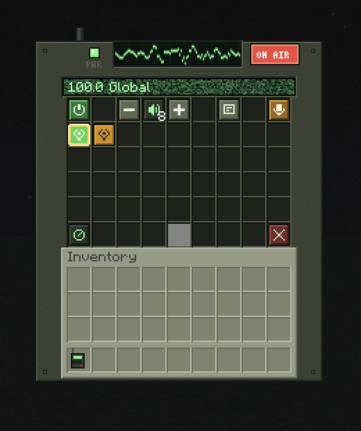

# Radio

Handheld radios for Paper 26.3 (Minecraft 26.3, Java 25): admin-defined channels with per-channel permissions, a
transceiver GUI, a message dialog or radio chat, radio sounds and per-player signal effects. The plugin carries its
own resource pack and serves it on the Minecraft port.



Status of 0.1.0: see [What is verified](#what-is-verified).

## Build and install

```
./gradlew build          # needs a JDK 25 or newer; the jar is build/libs/radio-0.1.0.jar
```

Put the jar in `plugins/` and start the server. Delete any older Radio jar first: Paper loads the first jar with the
same plugin name. LuckPerms and Simple Voice Chat are optional.

`python3 tools/gen_pack.py` regenerates the placeholder art, font, item models and sounds (sounds need `ffmpeg`).
`tools/zip_pack.sh` zips `resourcepack/` and prints the SHA-1.

## Architecture

| Package | What it does |
|---|---|
| `RadioPlugin` | wiring, reload |
| `config` | `RadioConfig` (config.yml snapshot with validation), `Messages` (messages.yml, MiniMessage) |
| `channels` | `Channel`, `ChannelRegistry` (channels.yml, saved asynchronously) |
| `permissions` | `Perms`: registers `radio.channel.<id>.*` nodes with their defaults |
| `item` | `RadioItem` (PDC state), `RadioLocator` (which carried radios work), `RadioTracker` (who hears what, refreshed every 10 ticks), `RadioItemListener` (right-click, recipe) |
| `chat` | `Transmitter` (checks, rate limit, delivery), `ChatListener` (radio chat) |
| `dialog` | `TalkDialog` (Paper Dialog API) |
| `gui` | `RadioMenu` (one open menu), `MenuManager` (clicks, refresh), `MenuTitle` (the art as a font title) |
| `sound` | `RadioSounds`: pack sound or vanilla fallback, per listener |
| `effects` | `PostFx`: per-player post effects through `Player.postEffects()` |
| `pack` | `PackBuilder`, `PackService`, `SamePortHttp`, `PackHttpServer` (same code as SuperbVehicles/CCTV/Lighting), `TextShaderMerge` |
| `storage` | `PlayerStore`: per-player input mode |
| `integration` | `LuckPermsHook`, `VoiceChatModule` (experimental); only loaded when those plugins are installed |
| `commands` | `RadioCommand` (Brigadier, `LifecycleEvents.COMMANDS`) |

```
build.gradle.kts  settings.gradle.kts
src/main/resources/   plugin.yml config.yml channels.yml messages.yml
src/main/java/fi/alavesa/radio/...
resourcepack/         pack.mcmeta (pack_format 97)
  assets/radio/font/gui.json            panel + lamps as bitmap glyphs, negative-space characters
  assets/radio/textures/font/*.png      panel 208x256, scope, on_air, led
  assets/radio/items|models|textures/item/...   the radio and the GUI buttons
  assets/radio/sounds.json  sounds/radio/*.ogg  lang/en_us.json
  assets/radio/post_effect/{gui,burst,active}.json  shaders/post/radio_fx.fsh
  assets/radio/shaders/include/radio_text_{vertex,fragment}.glsl  radio_layout.glsl (generated)
  (assets/minecraft/shaders/core/text.vsh|fsh are NOT in the folder: the plugin merges them at startup, see below)
tools/                gen_pack.py  zip_pack.sh  validate_shaders.py
```

The state of a radio (channel, power, volume) is stored on the item. A player hears a channel when they carry a
powered radio tuned to it (`radio.works-when`: held, hotbar or inventory) and have the listen permission.

## Commands

| Command | Permission |
|---|---|
| `/radio` open the GUI | `radio.use` |
| `/radio talk` open the message dialog | `radio.use` |
| `/radio say <message>` | `radio.use` |
| `/radio chat` toggle radio chat (input mode chat/dialog, remembered per player) | `radio.use` |
| `/radio power [on\|off]` | `radio.use` |
| `/radio pack` pack status, resend | `radio.use` |
| `/radio give <players> [amount]` | `radio.give` |
| `/radio channel create\|delete\|rename\|color\|frequency\|list` | `radio.admin` |
| `/radio reload` | `radio.reload` |

Right-click the radio to open it; sneak + right-click toggles the power.

## Permissions and LuckPerms

`radio.use` (default: everyone), `radio.give`, `radio.reload`, `radio.admin` (default: op; includes every channel).
Per channel: `radio.channel.<id>.listen`, `radio.channel.<id>.speak`, `radio.channel.<id>.*`, and `radio.channel.*`.
`global` is open to everyone; every other channel is closed until granted.

```
/radio channel create security <red>Security
/radio channel frequency security 144.8
/lp group guard permission set radio.channel.security.* true
/lp group default permission set radio.channel.security.listen true
/lp user Steve permission set radio.channel.global.speak false
/lp user Steve permission set essentials.fly true radio-channel=security
```

With LuckPerms installed the plugin registers the context `radio-channel=<id>` (the channel of the player's powered
radio), refreshes open radio GUIs when permissions change (`UserDataRecalculateEvent`), and can show the prefix and
suffix in radio messages (`<prefix>`, `<suffix>` in messages.yml; `chat.luckperms-meta`). Without LuckPerms the same
nodes work through any Bukkit permission plugin.

## Resource pack

Pack format 97 (Minecraft 26.3 only). `pack.delivery`:

- `auto` / `same-port`: served on the Minecraft port, nothing to open in a firewall. Not behind Velocity/Bungee.
- `http`: built-in HTTP server on `pack.http.port`.
- `url`: host `plugins/Radio/radio-pack.zip` yourself, set `pack.url` and `pack.sha1`.
- `none`: you merged the pack into another one.

It is sent as an additional pack with a fixed id, so the server's own pack keeps working. Players whose client did
not load it get the plain chest GUI and vanilla sounds. They also see the missing-model cube for the radio item unless
`item.model` is set to `""`.

### The text shader, shared with SuperbVehicles and CCTV

The moving waveform, the lamp glow and the display's scanlines and static are drawn by Minecraft's text shader
(`minecraft:core/text`). Only one pack's copy of a core shader runs (the pack pushed last), and SuperbVehicles and
CCTV replace the same shader. So the pack folder has no `text.vsh/fsh`. At startup `TextShaderMerge` takes the text
shader from `plugins/SuperbVehicles/pack/SuperbVehicles-hud.zip`, else from `plugins/CCTV/cctv-pack.zip`, else the
vanilla 26.3 files inside the jar; adds CCTV's hooks if they are missing; adds the Radio hooks; and copies the other
plugins' include files along. The merge is redone when those zips change. Neither other plugin needs changes.

- Radio sends its pack 40 ticks after join (`pack.send-delay-ticks`) and again when another pack is pushed after it,
  so its merged shader stays on top.
- If a line the hooks attach to is missing (a future version of one of the plugins changed its shader), no text
  shader is shipped and the console says so. The GUI then shows its still art. A core shader that fails to compile
  makes the client drop every server pack, so this is the safe direction.
- Marked glyphs use text colour `#FEFCxx` (xx = 255 - effect kind) and texel alpha 253. The colour is nearly white,
  so if another pack's text shader wins anyway, the glyphs are drawn as their still pictures.
- `pack.text-shader.enabled: false` turns all of this off.
- With `pack.source-folder` or a self-hosted pack, take the merged shader from `plugins/Radio/radio-pack.zip`.

After changing a shader, validate before shipping:

```
python3 tools/validate_shaders.py <glslang> <unzipped radio-pack>/assets,<26.3 client assets> text.vsh text.fsh -DIS_GUI
```

Run it without defines and with `-DIS_SEE_THROUGH` and `-DIS_GRAYSCALE` too.

### Replacing the art

Everything `tools/gen_pack.py` writes is a placeholder. Replace a PNG with one of the same size:
`textures/font/panel.png` is 208x256 and is drawn 16 px left of and 34 px above the 176x222 chest container; its
right-most pixel column must contain at least one opaque pixel. The small glyphs (`scope`, `on_air`, `led`, `lcd`)
keep their picture at the top of a taller transparent image, and every drawn pixel in them has alpha 253 (the shader
marker; `gen_pack.py` sets it). If you move them, change `GLYPHS` in `gen_pack.py` and the
constants in `MenuTitle.java` together. Button icons are 16x16 in `textures/item/gui/`; `channel.png` is tinted with
the channel colour, `channel_overlay.png` is not. Sounds are Ogg Vorbis in `sounds/radio/`.

## Limits worth knowing

- Post effects are drawn before the GUI. `radio:gui` changes the world behind the menu, never the menu.
- A chest title cannot be changed in place, so the menu is reopened when the channel, power or ON AIR lamp changes.
- Radio chat cancels the chat event and sends the text as a transmission on the next tick (hearing a channel depends
  on inventories, which must be read on the main thread). Chat plugins that listen at MONITOR will not see it.
- Sodium/Iris: fonts, item models and sounds are unaffected. Iris replaces the post-processing pipeline while a
  shader pack is active, so the post effects may not show then. Not tested.
- `SamePortHttp` reaches the server's listening channel by reflection (the only non-API code).

## What is verified

On Paper 26.3 with a real 26.3 client: the plugin loads without errors; the pack is delivered on the Minecraft port
and loads; the transceiver GUI, icons, channel tints, display text and ON AIR lamp render as in the screenshot; the
`radio:gui` post effect applies; `/radio say`, `give`, `channel ...`, `reload` work from the console. The text shader
effects (waveform, lamp pulse, scanlines, on-air static) run with Radio alone and with SuperbVehicles 0.7.0 and CCTV
0.7.0 installed on the same server. The merged shader passes glslang in all three combinations (vanilla, CCTV,
SuperbVehicles + CCTV) and every variant.

Not verified (needs a person at a client, or the other plugin):

- [ ] clicking every GUI button; scrolling with more than 32 channels
- [ ] the dialog: open from the GUI and `/radio talk`, channel selector, Send
- [ ] radio chat with a second player; public chat stays normal without a powered radio
- [ ] sounds: in, out, power, switch; vanilla fallbacks after declining the pack; the plain GUI after declining
- [ ] sneak + right-click power toggle; the recipe (`item.recipe.enabled`)
- [ ] the title follows `/radio power` while the GUI is open (fixed after the last client run)
- [ ] LuckPerms: context, live refresh, prefix/suffix
- [ ] Simple Voice Chat module (`voice.enabled`), never run against a voice server
- [ ] rate limit and max length messages; `/radio reload` with a broken config
- [ ] SuperbVehicles' vehicle HUD and CCTV's camera HUD and monitors while Radio's merged shader is the one running
      (their blocks are carried over unchanged and compile, but nobody has looked at them on a client)
- [ ] Lighting and Firearms packs on the same server

Version-sensitive: built against `paper-api 26.3.build.253-stable` and tested on server build 246; the Dialog API and
`Player.postEffects()` are recent Paper API; `pack_format` 97 is 26.3 only.
