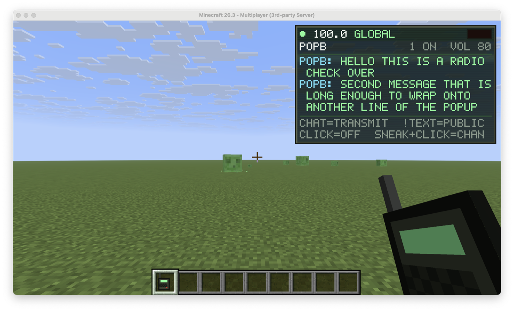

# Radio

Handheld radios for Paper 26.3 (Minecraft 26.3, Java 25): admin-defined channels with per-channel permissions, a radio
popup in the corner of the screen, radio chat, radio sounds and signal effects. The plugin carries its own resource
pack and serves it on the Minecraft port.



## How it plays

- **Right-click the radio**: on / off. The popup is there while the radio is on and gone when it is off.
- **Sneak + right-click**: next channel.
- **While it is on, type in chat**: the message is transmitted on the radio's channel. `!text` goes to public chat
  as usual (`chat.public-prefix`).
- The popup shows the channel, your name, how many are listening, the volume, the last radio messages and these
  controls. While a transmission comes in the lamp lights and the panel shows static
  ([picture](docs/popup-receiving.png)).
- A player hears a channel when they carry a powered radio tuned to it (`radio.works-when`: held, hotbar or
  inventory) and have the listen permission.

Players without the resource pack get a one-line boss bar instead of the popup and read radio messages in chat.

## Build and install

```
./gradlew build          # needs a JDK 25 or newer; the jar is build/libs/radio-0.2.1.jar
```

Put the jar in `plugins/` and restart. Delete any older Radio jar first: Paper loads the first jar with the same
plugin name. LuckPerms and Simple Voice Chat are optional.

`python3 tools/gen_pack.py` regenerates the placeholder art, font, item model and sounds (sounds need `ffmpeg`).
`tools/zip_pack.sh` zips `resourcepack/` and prints the SHA-1.

## Commands

| Command | Permission |
|---|---|
| `/radio` or `/radio power [on\|off]` | `radio.use` |
| `/radio tune <channel>` | `radio.use` |
| `/radio volume <0-100>` | `radio.use` |
| `/radio say <message>` transmit once | `radio.use` |
| `/radio pack` pack status, resend | `radio.use` |
| `/radio give <players> [amount]` | `radio.give` |
| `/radio channel create\|delete\|rename\|color\|frequency\|list` | `radio.admin` |
| `/radio reload` | `radio.reload` |

## Permissions and LuckPerms

`radio.use` (default: everyone), `radio.give`, `radio.reload`, `radio.admin` (default: op; includes every channel).
Per channel: `radio.channel.<id>.listen`, `radio.channel.<id>.speak`, `radio.channel.<id>.*`, and `radio.channel.*`.
`global` is open to everyone; every other channel is closed until granted.

```
/radio channel create security <red>Security
/radio channel frequency security 144.8
/lp group guard permission set radio.channel.security.* true
/lp group default permission set radio.channel.security.listen true
/lp user Steve permission set essentials.fly true radio-channel=security
```

With LuckPerms installed the plugin registers the context `radio-channel=<id>` (the channel of the player's powered
radio), refreshes the popup when permissions change, and can show the prefix and suffix in the chat form of radio
messages (`<prefix>`, `<suffix>` in messages.yml).

## How the popup is drawn

The request was a popup made with post effects. A post effect cannot do that on its own: Minecraft applies post
effects to the 3D view and draws the HUD afterwards, and a post shader gets no text and does not know the GUI scale.
So:

- The popup is the **name of a boss bar** (one per player, blue, progress 0), written in the font `radio:hud`. The
  font is monospace by construction and has signed space characters, so `HudText` can place every character; the
  whole name is 0 px wide, which puts its origin at the screen centre.
- The **text shader** (`minecraft:core/text`) moves glyphs marked with the text colour `#FEFBxx` from the centre to
  the corner and onto their line, colours them from a palette of eight, and animates the panel (scanlines, rolling
  bar, static and lamp while a transmission comes in).
- The pack makes the blue boss bar graphic transparent. No vanilla mob has a blue bar; another plugin's blue boss
  bars would lose their bar for players with this pack.
- **Post effects** add the burst of static around the top-right corner when a transmission comes in
  (`post-effects.transmission`), per player through `Player.postEffects()`.

The popup font has capitals, digits, common punctuation and Ä Ö Å Ü É. Lower case is shown as upper case, anything
else as `?`. Set `popup.messages-in-chat: true` if players should also get the full text in chat.

`popup.side`, `popup.scale`, `popup.margin-x` and `popup.margin-top` move and size it. Vanilla draws potion effect
icons in the same corner; `margin-top: 56` puts the popup below them.

### The text shader is shared with SuperbVehicles and CCTV

Only one pack's copy of a core shader runs (the pack pushed last), and SuperbVehicles and CCTV replace the same
shader. So the pack folder has no `text.vsh/fsh`. At startup `TextShaderMerge` takes the text shader from
`plugins/SuperbVehicles/pack/SuperbVehicles-hud.zip`, else from `plugins/CCTV/cctv-pack.zip`, else the vanilla 26.3
files inside the jar; adds CCTV's hooks if they are missing; adds the Radio hooks; and copies the other plugins'
include files along. The merge is redone when those zips change. Neither other plugin needs changes.

- Radio sends its pack 40 ticks after join (`pack.send-delay-ticks`) and again when another pack is pushed after it,
  so its merged shader stays on top.
- If a line the hooks attach to is missing (a future version of one of the plugins changed its shader), no text
  shader is shipped and the console says so. Everyone then gets the plain one-line bar. A core shader that fails to
  compile makes the client drop every server pack, so this is the safe direction.
- With `pack.source-folder` or a self-hosted pack, take the merged shader from `plugins/Radio/radio-pack.zip`.

After changing a shader, validate it BEFORE any client loads it:

```
python3 tools/validate_shaders.py <glslang> <unzipped radio-pack>/assets,<26.3 client assets> text.vsh text.fsh -DIS_GUI
```

Run it without defines and with `-DIS_SEE_THROUGH` and `-DIS_GRAYSCALE` too.

## The popup does not show

Run `/radio pack` as the player. It prints what the client reported for the Radio pack.

- **failed download**: the client could not fetch the pack, so the player gets the one-line bar. The console has a
  warning with the URL. Firearms 0.33.0 and older answer 404 to every pack download on the Minecraft port that is not
  their own; Radio 0.2.1 puts its own handler in front so its pack still arrives, but SuperbVehicles, CCTV and
  Lighting packs are still blocked by it until Firearms is updated.
- **declined** or **no answer yet**: the player has server resource packs off, or has not answered the prompt.
  Enabling a copy of the zip by hand in the resource pack menu does not count: the plugin only knows about the pack
  it sent.
- **successfully loaded** but only a line of text at the top of the screen: the console said "text shader not
  shipped" at startup (see below), or `popup.enabled` is false.
- **successfully loaded** and odd coloured text at the top centre: another pack's text shader is on top of Radio's.
  Rejoining pushes Radio's pack last again.

## Resource pack

Pack format 97 (Minecraft 26.3 only). `pack.delivery`:

- `auto` / `same-port`: served on the Minecraft port, nothing to open in a firewall. Not behind Velocity/Bungee.
- `http`: built-in HTTP server on `pack.http.port`.
- `url`: host `plugins/Radio/radio-pack.zip` yourself, set `pack.url` and `pack.sha1`.
- `none`: you merged the pack into another one.

It is sent as an additional pack with a fixed id, so the server's own pack keeps working. Players without it see the
missing-model cube for the radio item unless `item.model` is set to `""`.

### Replacing the art

Everything `tools/gen_pack.py` writes is a placeholder. `textures/font/panel.png` (176x104) is the popup's
background; translucent pixels are treated as glass and get the scanlines and static, opaque ones stay as drawn, and
its right-most column must be opaque. `lamp.png` is the lit lamp, as tall as the panel. `hud.png` is the font sheet
(5x8 cells); each cell keeps a nearly transparent pixel in its last column, which is what makes the font monospace.
If the geometry changes, change it in `gen_pack.py` (it writes `radio_layout.glsl`) and in `HudText.java` together.
Sounds are Ogg Vorbis in `sounds/radio/`.

## Code map

| Package | What it does |
|---|---|
| `RadioPlugin` | wiring, reload, power and tune |
| `config` | `RadioConfig` (config.yml snapshot with validation), `Messages` (messages.yml, MiniMessage) |
| `channels` | `Channel`, `ChannelRegistry` (channels.yml, saved asynchronously) |
| `permissions` | `Perms`: registers `radio.channel.<id>.*` nodes with their defaults |
| `item` | `RadioItem` (PDC state: channel, power, volume), `RadioLocator`, `RadioTracker`, `RadioItemListener` |
| `hud` | `RadioHud` (the boss bar per player, message log), `HudText` (layout and markers) |
| `chat` | `Transmitter` (checks, rate limit, delivery), `ChatListener` (radio chat) |
| `sound` | `RadioSounds`: pack sound or vanilla fallback, per listener |
| `effects` | `PostFx`: per-player post effects |
| `pack` | `PackBuilder`, `PackService`, `SamePortHttp`, `PackHttpServer`, `TextShaderMerge` |
| `integration` | `LuckPermsHook`, `VoiceChatModule` (experimental); only loaded when those plugins are installed |
| `commands` | `RadioCommand` (Brigadier, `LifecycleEvents.COMMANDS`) |

## Limits worth knowing

- Radio chat cancels the chat event and sends the text as a transmission on the next tick (hearing a channel depends
  on inventories, which must be read on the main thread). Chat plugins that listen at MONITOR will not see it.
- The popup takes one boss bar slot at the top of the screen (it is empty there); other boss bars move down a row.
- Sodium/Iris: fonts, item models and sounds are unaffected. Iris replaces core shaders and the post pipeline while
  a shader pack is active, so the popup may stay at the top centre and the burst may not show. Not tested.
- `SamePortHttp` reaches the server's listening channel by reflection (the only non-API code).

## What is verified

On Paper 26.3 (build 253) with a real 26.3 client: the plugin loads without errors; the pack is delivered on the
Minecraft port; the popup renders in the corner as in the screenshot, with messages, wrapping, the lamp and static
during a transmission; it disappears when the radio is switched off; the same with SuperbVehicles 0.7.0 and CCTV
0.7.0 installed, and with Firearms 0.33.0, Lighting 0.4.0, Vitals and Labra added. The merged shader passes glslang in every variant, with and without those two plugins.

Not verified (needs a person at a client, or the other plugin):

- [ ] the new sounds, by ear: transmission start, the "over" beep and squelch tail, power on/off, channel click
- [ ] right-click on/off and sneak + right-click channel change (driven by commands in the tests, not by clicks)
- [ ] typing in chat with a second player; `!text` reaching public chat; chat staying normal with the radio off
- [ ] the plain one-line bar and chat messages for a player who declined the pack
- [ ] the burst post effect in the corner; `popup.side: left`, `popup.scale` other than 1
- [ ] SuperbVehicles' vehicle HUD and CCTV's camera HUD and monitors while Radio's merged shader is running
- [ ] LuckPerms: context, live refresh, prefix/suffix; Simple Voice Chat module
- [ ] Lighting, Firearms and Vitals on the same server (Vitals also uses boss bars)

Version-sensitive: built against `paper-api 26.3.build.253-stable`; `Player.postEffects()` is recent Paper API;
`pack_format` 97 is 26.3 only.
